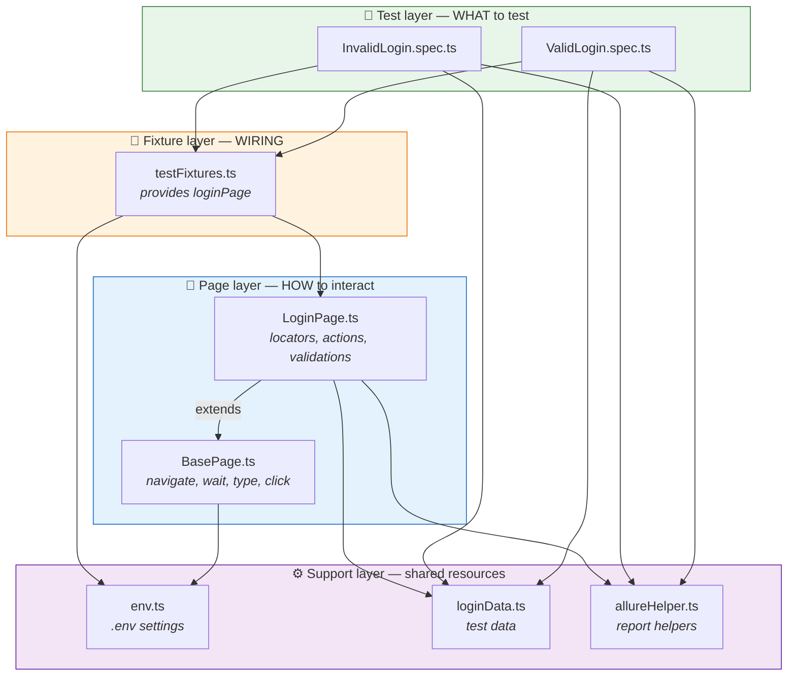
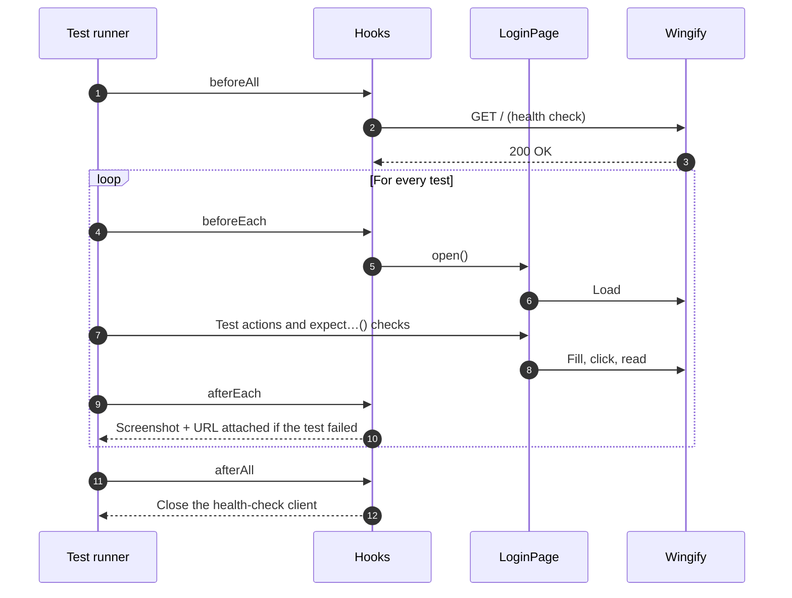

<div align="center">

# 🎭 Wingify Login Automation Framework

**Enterprise-grade Playwright + TypeScript test framework for the [Wingify login page](https://app.wingify.com/#/login)**

[](https://playwright.dev)
[](https://www.typescriptlang.org)
[](https://nodejs.org)
[](https://allurereport.org)


-lightgrey?style=flat-square)


[**Quick start**](#-quick-start) · [**Architecture**](#-architecture) · [**Test coverage**](#-test-coverage) · [**Reports**](#-reports) · [**Extending**](#-extending-the-framework) · [**FAQ**](#-troubleshooting--faq)

</div>

---

## 📑 Table of contents

<details open>
<summary><b>Click to collapse or expand</b></summary>

1. [Overview](#-overview)
2. [Highlights](#-highlights)
3. [Quick start](#-quick-start)
4. [Architecture](#-architecture)
5. [Project structure](#-project-structure)
6. [Test lifecycle](#-test-lifecycle)
7. [Test coverage](#-test-coverage)
8. [Configuration](#-configuration)
9. [Commands](#-commands)
10. [Reports](#-reports)
11. [Design principles](#-design-principles)
12. [Extending the framework](#-extending-the-framework)
13. [Troubleshooting & FAQ](#-troubleshooting--faq)
14. [Roadmap](#-roadmap)

</details>

---

## 🔍 Overview

This framework tests the Wingify login page end to end: page visibility, every form field, error handling, and successful login with session checks.

It was generated from a structured **RICE-POT** prompt ([`Playwirght.RICEPOT.md`](../Template_RICE_POT/Playwirght.RICEPOT.md)) and then **verified against the live application**. Every locator and every expected message was copied from the real page, not assumed.

> [!IMPORTANT]
> **Nothing is guessed.** When information is missing (for example, valid credentials), the affected test is **skipped** with the message *"Insufficient information to determine"* instead of passing on invented data.

---

## ✨ Highlights

<table>
<tr>
<td width="50%" valign="top">

### 🏗️ Clean architecture
- Page Object Model with a shared `BasePage`
- Custom fixture that injects `loginPage` into every test
- Tests contain **zero** locators and **zero** raw page actions

</td>
<td width="50%" valign="top">

### 🎯 Reliable by design
- **XPath-only** locators, scoped to the visible login form
- Auto-waiting with `waitFor()` and `expect()`; **no** `waitForTimeout()`
- Fresh, isolated browser context for every test

</td>
</tr>
<tr>
<td width="50%" valign="top">

### 📊 Rich reporting
- Allure: epic, feature, story, severity, readable steps
- Screenshot and URL attached automatically on failure
- Video and trace kept for failed tests

</td>
<td width="50%" valign="top">

### 🔐 Safe by default
- Credentials live only in `.env`, which is never committed
- Passwords are **never** written to the Allure results
- Negative tests use `example.com` addresses only, so no real account is locked out

</td>
</tr>
</table>

---

## 🚀 Quick start

> [!TIP]
> You can be running tests in **under two minutes**.

**1. Install dependencies and the browser**

```bash
npm install
npx playwright install chromium
```

**2. (Optional) Add credentials for the successful-login test**

```bash
cp .env.example .env
# then set WINGIFY_EMAIL and WINGIFY_PASSWORD in .env
```

**3. Run the tests**

```bash
npm test
```

**Expected output**

```text
Running 12 tests using 2 workers
  ok  1 › Wingify login - invalid scenarios › login is rejected: unregistered email and wrong password
  ...
  -  12 › Wingify login - valid scenarios › user with valid credentials is logged in and a session is created

  1 skipped
  11 passed (≈35s)
```

<details>
<summary><b>📋 Prerequisites</b></summary>

| Tool | Version | Needed for |
|---|---|---|
| [Node.js](https://nodejs.org) | 18 or later | Running the tests |
| npm | Comes with Node.js | Installing packages |
| [Java](https://adoptium.net) | 8 or later | **Only** for building the Allure HTML report |

</details>

---

## 🏛️ Architecture

Each layer has one job and depends only on the layer below it.



> [!NOTE]
> **Why it matters:** if Wingify changes a button, you update **one line** in `LoginPage.ts`. If an error message changes, you update **one line** in `loginData.ts`. No test file needs to change.

---

## 📁 Project structure

```text
PlaywrightFramework/
├── 📂 src/
│   ├── 📂 config/
│   │   └── env.ts              ⚙️  Reads settings from .env (URL, timeout, credentials)
│   ├── 📂 fixtures/
│   │   └── testFixtures.ts     🔌  Extends Playwright's test with a ready `loginPage`
│   ├── 📂 pages/
│   │   ├── BasePage.ts         🧱  Shared helpers every page inherits
│   │   └── LoginPage.ts        📄  XPath locators, actions, and validations
│   ├── 📂 test-data/
│   │   └── loginData.ts        📦  Expected texts and data-driven invalid cases
│   └── 📂 utils/
│       └── allureHelper.ts     📊  Labels, steps, and failure screenshots
├── 📂 tests/
│   ├── ValidLogin.spec.ts      ✅  Positive scenarios
│   └── InvalidLogin.spec.ts    ❌  Negative scenarios
├── playwright.config.ts        🎛️  Browser, reporters, timeouts, workers
├── .env.example                🔑  Template for local settings
├── tsconfig.json               🧩  TypeScript settings
└── package.json                📜  Dependencies and npm scripts
```

---

## 🔄 Test lifecycle

Every spec file follows the same lifecycle, so all tests behave consistently.



| Hook | Runs | Purpose |
|---|---|---|
| `test.beforeAll` | Once per file | Confirms the site responds before any browser starts |
| `test.beforeEach` | Before each test | Opens the login page in a fresh browser page |
| `test.afterEach` | After each test | Attaches evidence to Allure on failure |
| `test.afterAll` | Once per file | Cleans up the API client |

---

## 🧪 Test coverage

### ✅ Valid scenarios — `ValidLogin.spec.ts`

| # | Test | What is verified | Severity |
|:-:|---|---|:-:|
| 1 | Login page displayed | Title `Login - Wingify`, URL ends with `#/login`, form visible | 🔴 Blocker |
| 2 | Email field | Visible, editable, `type="email"`, placeholder, keeps typed value | 🟠 Critical |
| 3 | Password field | Masked by default; the eye button shows and hides it | 🟠 Critical |
| 4 | Sign in button | Visible, enabled, text `Sign in` | 🟠 Critical |
| 5 | Remember me | Ticks on the first click, unticks on the second | 🟡 Normal |
| 6 | Successful login | Leaves `#/login`, form hidden, session survives reload, cookies stored | 🔴 Blocker |

### ❌ Invalid scenarios — `InvalidLogin.spec.ts`

| # | Email | Password | Expected result |
|:-:|---|---|---|
| 1 | `invalid.user@example.com` | `WrongPass@123` | Error shown, stays on login page |
| 2 | *(empty)* | *(empty)* | Error shown, stays on login page |
| 3 | `invalid.user@example.com` | *(empty)* | Error shown, stays on login page |
| 4 | *(empty)* | `WrongPass@123` | Error shown, stays on login page |
| 5 | `invaliduser` | `WrongPass@123` | Error shown, stays on login page |
| 6 | `invalid.user@example.com` | `WrongPass@123` | Password cleared, email kept |

> [!NOTE]
> Wingify shows **one message for every failed login**, verified on the live page:
> *"Your email, password, IP address or location did not match"*.
> This is a deliberate security pattern: it does not reveal whether the email exists.

<details>
<summary><b>📐 Requirement traceability (prompt → test)</b></summary>

| Requirement from the prompt | Covered by |
|---|---|
| Login page visibility | Valid #1 |
| Email field | Valid #2 |
| Password field | Valid #3 |
| Sign in button | Valid #4 |
| Remember me | Valid #5 |
| Successful login navigation | Valid #6 |
| Session creation after login | Valid #6 |
| URL validation | Valid #1, #6 · Invalid #1–5 |
| Error messages | Invalid #1–6 |
| Invalid credential handling | Invalid #1–5 |
| Field validation behaviour | Valid #2, #3 · Invalid #6 |

</details>

---

## ⚙️ Configuration

All settings live in `.env`, so the same code runs against any environment.

```bash
cp .env.example .env
```

| Variable | Default | Description |
|---|---|---|
| `BASE_URL` | `https://app.wingify.com` | Application address |
| `LOGIN_PATH` | `/#/login` | Route of the login page |
| `WINGIFY_EMAIL` | *(empty)* | Real account email, used by the successful-login test |
| `WINGIFY_PASSWORD` | *(empty)* | Real account password |
| `TIMEOUT_MS` | `20000` | Maximum wait for an element, in milliseconds |
| `HEADLESS` | `true` | Set to `false` to watch the browser |

> [!CAUTION]
> **Never commit `.env`.** It is listed in `.gitignore`. Share settings through `.env.example` only, without real values.

---

## 💻 Commands

| Command | What it does |
|---|---|
| `npm test` | Runs all tests **headless** |
| `npm run test:headed` | Runs all tests with a **visible browser** |
| `npm run typecheck` | Checks the TypeScript code for errors |
| `npm run report:html` | Opens Playwright's HTML report |
| `npm run allure:generate` | Builds the Allure report into `allure-report/` |
| `npm run allure:open` | Opens the Allure report in a browser |

<details>
<summary><b>🎯 Running a subset of tests</b></summary>

```bash
# One file
npx playwright test tests/InvalidLogin.spec.ts

# Tests whose name matches a word
npx playwright test -g "Remember me"

# Step through a test with the Playwright Inspector
npx playwright test -g "Sign in button" --debug

# Interactive UI mode: pick, watch, and time-travel through tests
npx playwright test --ui
```

</details>

---

## 📊 Reports

<table>
<tr>
<th>Allure report</th>
<th>Playwright HTML report</th>
</tr>
<tr>
<td valign="top">

```bash
npm run allure:generate
npm run allure:open
```

- Grouped by **Epic → Feature → Story**
- Severity on every test
- Readable steps such as *"Enter email"* and *"Verify error message"*
- Screenshot and URL on failure

</td>
<td valign="top">

```bash
npm run report:html
```

- Built in, no Java needed
- **Trace viewer** for failed tests: DOM, network, and console at every step
- Video of failed tests

</td>
</tr>
</table>

> [!TIP]
> To investigate a failure, open the **trace** in the HTML report. It replays the test step by step, showing exactly what the browser saw.

---

## 🧭 Design principles

<details>
<summary><b>1. XPath only, scoped to the login form</b></summary>

The page contains hidden forms (forgot password, SSO, password reset) that reuse the same field names. Every locator therefore starts from the visible login form:

```ts
private static readonly FORM = "//form[@id='js-login-form']";
this.emailInput = this.xpath(`${FORM}//input[@id='login-username']`);
```

This prevents the test from typing into a hidden field.

</details>

<details>
<summary><b>2. No fixed waits</b></summary>

Synchronisation uses only `locator.waitFor()` and web-first `expect()` assertions, which retry until the condition is met or the timeout runs out. `waitForTimeout()` and other fixed delays are never used.

```ts
await element.waitFor({ state: 'visible', timeout: ENV.timeout });
await expect(this.errorMessage).toHaveText(message);
```

</details>

<details>
<summary><b>3. Tests describe intent; page objects hold the details</b></summary>

```ts
test('login is rejected: empty email and empty password', async ({ loginPage }) => {
  await loginPage.login('', '');
  await loginPage.expectErrorMessage(LOGIN_ERROR_MESSAGE);
  await loginPage.expectOnLoginUrl();
});
```

A reader understands the test without knowing a single locator.

</details>

<details>
<summary><b>4. Data-driven negative tests</b></summary>

Invalid cases are rows in `loginData.ts`. The spec file loops over them and creates one test per row, so adding coverage never means copying code.

</details>

<details>
<summary><b>5. Honest results</b></summary>

- Missing credentials → the test is **skipped**, never faked.
- The post-login page is not specified, so the success check is labelled **"Inference (low confidence)"** in the report.

</details>

---

## 🧩 Extending the framework

<details>
<summary><b>➕ Add a new invalid-login case</b></summary>

Add one row to `INVALID_LOGIN_CASES` in `src/test-data/loginData.ts`:

```ts
{ title: 'email with spaces', email: ' user@example.com ', password: 'WrongPass@123' },
```

A new test appears automatically. No other file changes.

</details>

<details>
<summary><b>📄 Add a new page object</b></summary>

1. Create `src/pages/DashboardPage.ts`:

   ```ts
   import { type Locator, type Page } from '@playwright/test';
   import { BasePage } from './BasePage';

   export class DashboardPage extends BasePage {
     readonly header: Locator;

     constructor(page: Page) {
       super(page);
       this.header = this.xpath("//header");
     }
   }
   ```

2. Register it in `src/fixtures/testFixtures.ts`:

   ```ts
   dashboardPage: async ({ page }, use) => {
     await use(new DashboardPage(page));
   },
   ```

3. Use it in any test: `async ({ dashboardPage }) => { ... }`

</details>

<details>
<summary><b>🌐 Run on more browsers</b></summary>

Add projects in `playwright.config.ts`:

```ts
projects: [
  { name: 'chromium', use: { ...devices['Desktop Chrome'] } },
  { name: 'firefox',  use: { ...devices['Desktop Firefox'] } },
  { name: 'webkit',   use: { ...devices['Desktop Safari'] } },
],
```

Then install them with `npx playwright install`.

</details>

<details>
<summary><b>🌍 Point at another environment</b></summary>

Change `BASE_URL` in `.env`, or set it for a single run:

```bash
BASE_URL=https://staging.example.com npm test
```

</details>

---

## 🛠️ Troubleshooting & FAQ

<details>
<summary><b>The successful-login test is always skipped</b></summary>

`WINGIFY_EMAIL` and `WINGIFY_PASSWORD` are not set. Add them to `.env`. The test skips on purpose rather than guessing credentials.

</details>

<details>
<summary><b><code>allure</code> fails with "JAVA_HOME is not set"</b></summary>

The Allure report builder needs Java. Install Java 8 or later and make sure `java -version` works. The tests themselves do not need Java.

</details>

<details>
<summary><b>Tests time out on a slow network</b></summary>

Raise `TIMEOUT_MS` in `.env`, for example to `40000`.

</details>

<details>
<summary><b>Error: "Executable doesn't exist" for Chromium</b></summary>

Run `npx playwright install chromium`.

</details>

<details>
<summary><b>Why only 2 parallel workers?</b></summary>

Wingify checks IP address and location on login. Keeping the number of simultaneous attempts low avoids triggering rate limits or account protection.

</details>

---

## 🗺️ Roadmap

- [x] Page Object Model with a shared base page
- [x] XPath-only locators verified against the live page
- [x] Data-driven invalid-login tests
- [x] Allure reporting without password leaks
- [ ] Run the successful-login test with a real account
- [ ] Add a CI pipeline (GitHub Actions) that publishes the Allure report
- [ ] Add Firefox and WebKit projects
- [ ] Cover Forgot Password, SSO, and Passkey flows

---

<div align="center">

**Built with a RICE-POT prompt and verified against the live application.**

Part of [AI Tester Blueprint 5X](../../../README.md) · Created by **Tushar Shetty** ([@Tush783](https://github.com/Tush783))

[⬆ Back to top](#-wingify-login-automation-framework)

</div>
