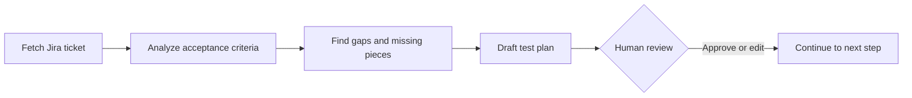

# AI Tester Blueprint 5X

A hands-on record of learning to apply AI to software testing. The work so far covers two areas:

- **Agent Skills:** reusable instruction packages that teach an AI assistant to carry out QA tasks consistently, such as turning a Jira ticket into a test plan a person can review.
- **Prompt engineering:** structured prompts (RICE-POT) that produce runnable test automation, such as a Selenium framework for the Salesforce login page.

## Contents

- [Learning progress](#learning-progress)
- [Repository structure](#repository-structure)
- [Key learnings](#key-learnings)
- [Skills](#skills)
- [Selenium framework from a RICE-POT prompt](#selenium-framework-from-a-rice-pot-prompt)
- [Getting started](#getting-started)
- [Sample output](#sample-output)
- [Roadmap](#roadmap)
- [Author and license](#author-and-license)

## Learning progress

| Chapter | Topic | Status |
|---|---|---|
| 00 | [Skill basics](Chapter_00_SKILL_Basics/) | In progress |
| 01 | LLM basics | Planned |
| 02 | [Prompt engineering](Chapter_02_Prompt_Engineering/) | In progress |

## Repository structure

```text
AITesterBlueprint5X/
├── Chapter_00_SKILL_Basics/
│   ├── 00_basics_skills/                  # First skills, built from a single SKILL.md
│   │   ├── apitestcase-response-validator-skill/
│   │   ├── testcase-creator-skill/
│   │   └── testplan-creator-skill/
│   ├── 01_advance_skills/
│   │   └── testplan-creator-skill_a/      # Skill split into instructions, references, and scripts
│   │       ├── SKILL.md                   # Workflow, output shape, and rules
│   │       ├── references/                # Gap checklist and test plan template
│   │       ├── scripts/                   # Jira fetch script
│   │       └── misc/                      # Company context and logo
│   └── output/                            # Sample test plan in HTML and PDF
├── Chapter_02_Prompt_Engineering/
│   └── RICE_POT/
│       ├── Template_RICE_POT/             # Blank RICE-POT prompt template
│       ├── REALPROMPT_RICE_POT.md         # Filled prompt: Salesforce login automation
│       └── SeleniumFramework/             # Maven project generated from that prompt
│           ├── pom.xml                    # Selenium, TestNG, and Allure dependencies
│           ├── testng.xml                 # Suite: base URL, timeout, test classes
│           ├── mvnw, mvnw.cmd             # Maven Wrapper (no Maven install needed)
│           └── src/
│               ├── main/java/.../pages/LoginPage.java
│               └── test/java/.../tests/
│                   ├── ValidLoginTest.java
│                   └── InvalidLoginTest.java
└── learnings/                             # Short write-ups of problems solved
```

## Key learnings

### 1. How a skill is put together

A skill is a folder with a `SKILL.md` file at its root. That file has two parts:

- **Frontmatter:** metadata such as the name, version, and author, plus a `description` that says what the skill does and which requests should trigger it.
- **Instructions:** the role, core principles, workflow, and expected output.

### 2. Moving from a basic skill to an advanced one

| | Basic skill | Advanced skill |
|---|---|---|
| **Structure** | One `SKILL.md` containing everything | `SKILL.md` plus supporting folders |
| **Input** | A PRD or details supplied by the user | A Jira ticket or pasted acceptance criteria |
| **Template** | Embedded in `SKILL.md` | Kept in `references/` |
| **Outside systems** | None | Jira, through a script |
| **Result** | A test plan document | A draft that must pass human review |

### 3. Keeping a person in control

AI output in testing should be treated as a draft. The advanced skill is designed around this principle:

- **Surface gaps:** report what is missing or ambiguous instead of filling it in silently.
- **Stay grounded:** do not assume anything that the ticket or the user has not provided.
- **Stop for review:** end every plan with its assumptions and open questions, and wait for approval before continuing.



### 4. Checking requirements before writing tests

The [requirement checklist](Chapter_00_SKILL_Basics/01_advance_skills/testplan-creator-skill_a/references/requirement-checklist.md) scores each item as present, ambiguous, or missing. Every ambiguous or missing item becomes a question for the ticket author. It covers five areas:

- Functional behaviour
- Data and environment
- Non-functional requirements, which are often missing
- Cross-cutting impact, such as regression and rollback
- Clarity of wording

### 5. Connecting a skill to real systems safely

[`fetch-jira.sh`](Chapter_00_SKILL_Basics/01_advance_skills/testplan-creator-skill_a/scripts/fetch-jira.sh) applies several habits that carry over to any integration:

- Read credentials from environment variables, never from source files.
- Validate input before sending a request.
- Send data to `stdout` and errors to `stderr`, with a non-zero exit code on failure.
- Keep `.env` files out of version control.

## Skills

| Skill | Purpose | Status |
|---|---|---|
| [`testplan-creator-skill`](Chapter_00_SKILL_Basics/00_basics_skills/testplan-creator-skill/SKILL.md) | Creates a test plan from a PRD or user-supplied details, using a fixed template | Drafted |
| [`advance-testplan-creator-skill`](Chapter_00_SKILL_Basics/01_advance_skills/testplan-creator-skill_a/SKILL.md) | Turns a Jira ticket into a test plan for human review | In progress |
| [`testcase-creator-skill`](Chapter_00_SKILL_Basics/00_basics_skills/testcase-creator-skill/SKILL.md) | Not yet defined | Placeholder |
| [`apitestcase-response-validator-skill`](Chapter_00_SKILL_Basics/00_basics_skills/apitestcase-response-validator-skill/SKILL.md) | Not yet defined | Placeholder |

## Selenium framework from a RICE-POT prompt

[`REALPROMPT_RICE_POT.md`](Chapter_02_Prompt_Engineering/RICE_POT/REALPROMPT_RICE_POT.md) uses the RICE-POT structure (Role, Instructions, Context, Example, Parameters, Output, Tone) plus anti-hallucination guardrails. From it, an AI assistant built the [`SeleniumFramework`](Chapter_02_Prompt_Engineering/RICE_POT/SeleniumFramework/) project, which tests the [Salesforce login page](https://login.salesforce.com/?locale=in).

### What the prompt required

- Selenium with Java, TestNG annotations, and Maven
- Page Object Model with PageFactory (`@FindBy`)
- XPath locators only
- `try`/`catch` exception handling in the page object and the tests
- Explicit waits only, with no `Thread.sleep`
- Allure reporting
- One page object and two test classes: valid and invalid login

### Test cases

| Class | Test | Checks |
|---|---|---|
| `ValidLoginTest` | Page title | The title is `Login \| Salesforce` |
| | Form elements | Username box, Log In button, and Remember me are shown |
| | Username step | Submitting a username shows the password box and the identity card |
| | Password masking | The password box keeps the typed value and hides it |
| | Remember me | The checkbox ticks and unticks |
| | Real login | Valid credentials leave the login page; skipped if none are provided |
| `InvalidLoginTest` | Wrong credentials | Two data rows; shows "Please check your username and password." |
| | Empty username | Shows "Please enter your username." |
| | Empty password | Shows "Please enter your password." |
| | Both fields empty | Shows "Please enter your username." |
| | Non-email username | Rejected on the username step |
| | Password cleared | The password box is empty after a failed login |

### What the live page taught us

The prompt describes one form with a username, a password, and a submit button. Running the tests against the live page showed three differences, and the page object handles each one:

- **Two-step login:** the password box appears only after a username is submitted.
- **Second page variant:** the same URL sometimes serves a "Log In with Email" page. The page object clicks "Log In with Username" to return to the normal form.
- **Error text:** messages start with `Error: `, so the tests check that the expected text is contained in the message.

### Run the tests

You need Java 21 and Google Chrome. The Maven Wrapper downloads Maven the first time, and Selenium Manager downloads the matching ChromeDriver.

```powershell
cd Chapter_02_Prompt_Engineering/RICE_POT/SeleniumFramework

.\mvnw.cmd clean test                   # Chrome window visible (default)
.\mvnw.cmd clean test -Dheadless=true   # no browser window
.\mvnw.cmd allure:report                # HTML report in target/site/allure-maven-plugin/
```

On macOS or Linux, use `./mvnw` instead of `.\mvnw.cmd`.

The real-login test reads credentials from `-Dsf.username` and `-Dsf.password`, or from a `.env` file in the project folder:

```text
VALID_USERNAME=your-salesforce-username
VALID_PASSWORD=your-salesforce-password
```

> [!NOTE]
> Latest run: 12 of 13 tests pass. The real-login test fails because the local `.env` holds placeholder credentials, not a real Salesforce account.

## Getting started

### Prerequisites

- An AI coding assistant that supports Agent Skills, such as Claude Code
- Bash (on Windows, use Git Bash) and `curl`
- A Jira Cloud account and [API token](https://id.atlassian.com/manage-profile/security/api-tokens), for the Jira script only
- Java 21 and Google Chrome, for the Selenium framework only

### Install a skill

```bash
git clone https://github.com/Tush783/AITesterBlueprint5X.git
cd AITesterBlueprint5X
mkdir -p .claude/skills
cp -r Chapter_00_SKILL_Basics/01_advance_skills/testplan-creator-skill_a .claude/skills/
```

Then ask your assistant something like: *"Write a test plan for VWO-1234."*

### Fetch a Jira ticket

```bash
export JIRA_BASE_URL='https://your-company.atlassian.net'
export JIRA_EMAIL='your-email@company.com'
export JIRA_API_TOKEN='your-api-token'

./Chapter_00_SKILL_Basics/01_advance_skills/testplan-creator-skill_a/scripts/fetch-jira.sh VWO-1234
```

The script prints the ticket as JSON and exits with one of these codes:

| Exit code | Meaning |
|---|---|
| `0` | Ticket fetched |
| `1` | Jira returned an error |
| `2` | Invalid arguments, ticket key, or environment variables |
| Other | `curl` failed, for example because the server could not be reached |

> [!WARNING]
> Never commit API tokens or personal credentials. Keep them in `.env`, which this repository ignores.

## Sample output

The [`output`](Chapter_00_SKILL_Basics/output/) folder contains a sample test plan for the VWO login dashboard, as [HTML](Chapter_00_SKILL_Basics/output/VWO_Login_Dashboard_Test_Plan.html) and [PDF](Chapter_00_SKILL_Basics/output/VWO_Login_Dashboard_Test_Plan.pdf). It covers:

- Objective, scope, and inclusions
- Test environments, strategy, and schedule
- Deliverables, plus entry and exit criteria
- Test execution and defect reporting
- Tools, risks and mitigations, and approvals
- Open clarifications

## Roadmap

- [ ] Point the advanced skill's workflow to `fetch-jira.sh` and its `references/` files
- [ ] Complete its empty sections: guardrails, references, anti-hallucination rules, and when not to use it
- [ ] Align its output shape with the test plan template
- [ ] Test `fetch-jira.sh` against a live Jira site
- [ ] Build the test case creator and API response validator skills
- [ ] Add Chapter 01: LLM basics
- [x] Add Chapter 02: Prompt engineering, with a RICE-POT template and a Selenium framework
- [ ] Run the real-login test with a real Salesforce account
- [ ] Stop Allure from recording passwords: `@Step` saves method arguments in `target/allure-results`

## Author and license

Created by **Tushar Shetty** ([@Tush783](https://github.com/Tush783)).

The drafted skills declare the MIT license in their metadata. The repository does not yet include a `LICENSE` file.
