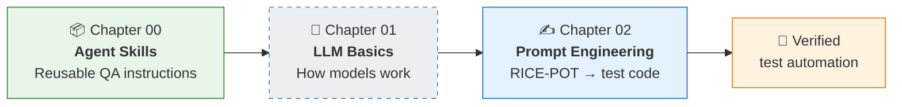
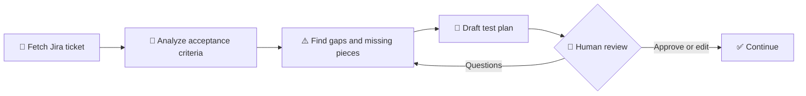
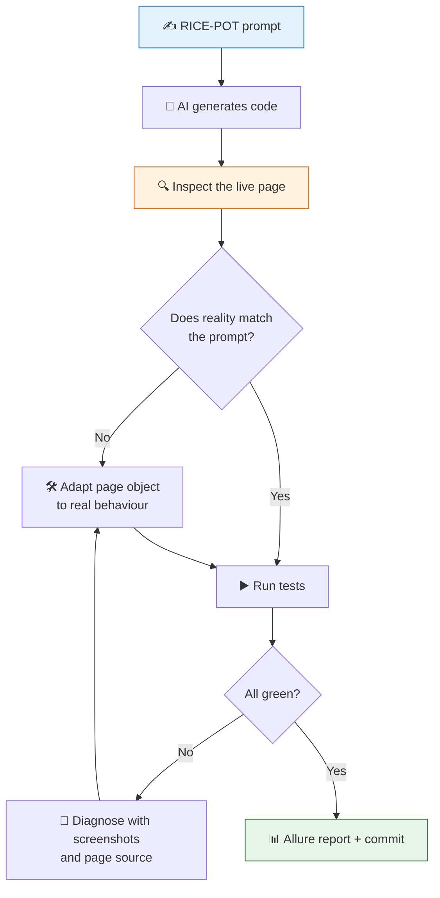

<div align="center">

# 🧠 AI Tester Blueprint 5X

### Applying AI to software testing, one chapter at a time

*A hands-on learning record: from reusable **Agent Skills**, through **prompt engineering**, to **production-style test automation** generated by AI and verified against live applications.*

<br/>

[](#-learning-path)
[](#-agent-skills)
[](#-test-automation-frameworks)
[](#-roadmap)


[**Learning path**](#-learning-path) · [**Quick start**](#-quick-start) · [**Frameworks**](#-test-automation-frameworks) · [**Skills**](#-agent-skills) · [**Key lessons**](#-key-lessons) · [**Roadmap**](#-roadmap)

</div>

---

## 📑 Table of contents

<details open>
<summary><b>Click to collapse or expand</b></summary>

1. [Why this repository exists](#-why-this-repository-exists)
2. [Learning path](#-learning-path)
3. [Repository structure](#-repository-structure)
4. [Quick start](#-quick-start)
5. [Chapter 00 — Agent Skills](#-chapter-00--agent-skills)
6. [Chapter 02 — Prompt engineering with RICE-POT](#-chapter-02--prompt-engineering-with-rice-pot)
7. [Test automation frameworks](#-test-automation-frameworks)
8. [Agent skills](#-agent-skills)
9. [Key lessons](#-key-lessons)
10. [Security practices](#-security-practices)
11. [Roadmap](#-roadmap)
12. [Author and license](#-author-and-license)

</details>

---

## 🎯 Why this repository exists

AI can write test plans and automation code in seconds, but **speed is worthless without trust**. This repository explores one question:

> **How do you get AI output that a QA professional can actually rely on?**

The answer, built up chapter by chapter, rests on three habits:

<table>
<tr>
<td width="33%" align="center" valign="top">

### 📐 Structure the ask
Reusable **skills** and structured **RICE-POT prompts** instead of one-off chat messages.

</td>
<td width="33%" align="center" valign="top">

### 🔍 Verify against reality
Every locator and message is checked on the **live application**, never assumed.

</td>
<td width="33%" align="center" valign="top">

### 👤 Keep a human in control
AI output is a **draft**. Gaps are surfaced, assumptions labelled, and review comes before "final".

</td>
</tr>
</table>

---

## 🗺️ Learning path



| Chapter | Topic | What you will find | Status |
|:-:|---|---|:-:|
| 00 | [Skill basics](Chapter_00_SKILL_Basics/) | Basic and advanced Agent Skills, a Jira integration, a sample test plan | 🟢 In progress |
| 01 | LLM basics | — | ⚪ Planned |
| 02 | [Prompt engineering](Chapter_02_Prompt_Engineering/) | RICE-POT templates and two AI-generated test frameworks | 🟢 In progress |

---

## 📁 Repository structure

<details>
<summary><b>Show the full tree</b></summary>

```text
AITesterBlueprint5X/
├── 📂 Chapter_00_SKILL_Basics/
│   ├── 📂 00_basics_skills/                 First skills, each a single SKILL.md
│   │   ├── apitestcase-response-validator-skill/
│   │   ├── testcase-creator-skill/
│   │   └── testplan-creator-skill/
│   ├── 📂 01_advance_skills/
│   │   └── testplan-creator-skill_a/        Skill split into instructions, references, scripts
│   │       ├── SKILL.md                     Workflow, output shape, and rules
│   │       ├── references/                  Gap checklist and test plan template
│   │       ├── scripts/fetch-jira.sh        Jira fetch script
│   │       └── misc/                        Company context and logo
│   └── 📂 output/                           Sample test plan (HTML and PDF)
│
├── 📂 Chapter_01_LLM_Basics/                Planned
│
├── 📂 Chapter_02_Prompt_Engineering/
│   └── 📂 RICE_POT/
│       ├── 📂 Template_RICE_POT/
│       │   ├── Template.RICEPPOT.md         Blank RICE-POT template
│       │   └── Playwirght.RICEPOT.md        Prompt: Wingify login, Playwright
│       ├── REALPROMPT_RICE_POT.md           Prompt: Salesforce login, Selenium
│       ├── 📂 SeleniumFramework/            Java · Selenium · TestNG · Allure
│       └── 📂 PlaywrightFramework/          TypeScript · Playwright · Allure
│
└── 📂 learnings/                            Short write-ups of problems solved
```

</details>

---

## 🚀 Quick start

```bash
git clone https://github.com/Tush783/AITesterBlueprint5X.git
cd AITesterBlueprint5X
```

Then pick what you want to try:

<details>
<summary><b>🎭 Run the Playwright framework (Wingify login)</b></summary>

Requires Node.js 18 or later.

```bash
cd Chapter_02_Prompt_Engineering/RICE_POT/PlaywrightFramework
npm install
npx playwright install chromium
npm test                    # headless
```

Full guide: [PlaywrightFramework/README.md](Chapter_02_Prompt_Engineering/RICE_POT/PlaywrightFramework/README.md)

</details>

<details>
<summary><b>☕ Run the Selenium framework (Salesforce login)</b></summary>

Requires Java 21 and Google Chrome. The Maven Wrapper downloads Maven on first run.

```powershell
cd Chapter_02_Prompt_Engineering/RICE_POT/SeleniumFramework
.\mvnw.cmd clean test                   # visible browser (default)
.\mvnw.cmd clean test -Dheadless=true   # no browser window
.\mvnw.cmd allure:report                # report in target/site/allure-maven-plugin/
```

On macOS or Linux, use `./mvnw` instead of `.\mvnw.cmd`.

</details>

<details>
<summary><b>📦 Install an Agent Skill in Claude Code</b></summary>

```bash
mkdir -p .claude/skills
cp -r Chapter_00_SKILL_Basics/01_advance_skills/testplan-creator-skill_a .claude/skills/
```

Then ask your assistant: *"Write a test plan for VWO-1234."*

</details>

<details>
<summary><b>🎫 Fetch a Jira ticket</b></summary>

```bash
export JIRA_BASE_URL='https://your-company.atlassian.net'
export JIRA_EMAIL='your-email@company.com'
export JIRA_API_TOKEN='your-api-token'

./Chapter_00_SKILL_Basics/01_advance_skills/testplan-creator-skill_a/scripts/fetch-jira.sh VWO-1234
```

| Exit code | Meaning |
|:-:|---|
| `0` | Ticket fetched |
| `1` | Jira returned an error |
| `2` | Invalid arguments, ticket key, or environment variables |
| Other | `curl` failed, for example because the server could not be reached |

Get an API token at [id.atlassian.com](https://id.atlassian.com/manage-profile/security/api-tokens).

</details>

---

## 📦 Chapter 00 — Agent Skills

A **skill** is a folder with a `SKILL.md` file that teaches an AI assistant to carry out a task the same way every time.

<details>
<summary><b>How a skill is put together</b></summary>

`SKILL.md` has two parts:

- **Frontmatter:** name, version, author, and a `description` that says what the skill does and which requests should trigger it.
- **Instructions:** the role, core principles, workflow, and expected output.

</details>

<details>
<summary><b>Basic skill vs. advanced skill</b></summary>

| | Basic skill | Advanced skill |
|---|---|---|
| **Structure** | One `SKILL.md` containing everything | `SKILL.md` plus supporting folders |
| **Input** | A PRD or details supplied by the user | A Jira ticket or pasted acceptance criteria |
| **Template** | Embedded in `SKILL.md` | Kept in `references/` |
| **Outside systems** | None | Jira, through a script |
| **Result** | A test plan document | A draft that must pass human review |

</details>

The advanced skill keeps a person in control at every step:



📄 **Sample output:** a test plan for the VWO login dashboard, as [HTML](Chapter_00_SKILL_Basics/output/VWO_Login_Dashboard_Test_Plan.html) and [PDF](Chapter_00_SKILL_Basics/output/VWO_Login_Dashboard_Test_Plan.pdf).

---

## ✍️ Chapter 02 — Prompt engineering with RICE-POT

**RICE-POT** is a structure for prompts that produce reliable technical output. Each letter is one section of the prompt:

| Letter | Section | Answers the question | Example |
|:-:|---|---|---|
| **R** | Role | Who should the AI act as? | *"Senior QA engineer with 15+ years' experience"* |
| **I** | Instructions | What exactly must be done, and what is forbidden? | *"Use XPath only. No fixed waits."* |
| **C** | Context | What system and inputs is this about? | *"Wingify login page with email, password, Remember me"* |
| **E** | Example | What does good output look like? | *A sample page object class* |
| **P** | Parameters | What quality rules apply? | *"Deterministic, traceable, no invented data"* |
| **O** | Output | What format and files? | *"LoginPage.ts, two spec files, config"* |
| **T** | Tone | How should it read? | *"Technical, enterprise-grade, code only"* |

> [!TIP]
> Start from the [blank template](Chapter_02_Prompt_Engineering/RICE_POT/Template_RICE_POT/Template.RICEPPOT.md). Its recommended **Parameters** block adds anti-hallucination rules, such as answering *"Insufficient information to determine"* instead of guessing.

### From prompt to verified framework



---

## 🧪 Test automation frameworks

Both frameworks were generated from RICE-POT prompts, then run and corrected against the live sites.

<table>
<tr>
<th width="50%">☕ Selenium framework</th>
<th width="50%">🎭 Playwright framework</th>
</tr>
<tr>
<td valign="top">

**Application:** [Salesforce login](https://login.salesforce.com/?locale=in)
**Prompt:** [`REALPROMPT_RICE_POT.md`](Chapter_02_Prompt_Engineering/RICE_POT/REALPROMPT_RICE_POT.md)

| | |
|---|---|
| Language | Java 21 |
| Stack | Selenium 4 · TestNG · Maven |
| Pattern | Page Object Model + PageFactory |
| Locators | XPath only |
| Reports | Allure |
| Default mode | Visible browser |
| Last run | **12 / 13 pass** |

</td>
<td valign="top">

**Application:** [Wingify login](https://app.wingify.com/#/login)
**Prompt:** [`Playwirght.RICEPOT.md`](Chapter_02_Prompt_Engineering/RICE_POT/Template_RICE_POT/Playwirght.RICEPOT.md)

| | |
|---|---|
| Language | TypeScript 7 |
| Stack | Playwright Test · Node.js |
| Pattern | Page Object Model + fixtures |
| Locators | XPath only |
| Reports | Allure + Playwright HTML |
| Default mode | Headless |
| Last run | **11 pass · 1 skipped** |

</td>
</tr>
<tr>
<td valign="top">

📖 [Selenium framework folder](Chapter_02_Prompt_Engineering/RICE_POT/SeleniumFramework/)

</td>
<td valign="top">

📖 [Playwright README](Chapter_02_Prompt_Engineering/RICE_POT/PlaywrightFramework/README.md)

</td>
</tr>
</table>

> [!NOTE]
> **About the non-passing tests:** both are the *real-login* tests, which need a real account.
> Selenium's `.env` holds placeholder credentials, so Salesforce correctly rejects them.
> Playwright has no credentials set, so the test is **skipped** instead of faking a pass.

<details>
<summary><b>☕ Selenium — test cases</b></summary>

| Class | Test | Checks |
|---|---|---|
| `ValidLoginTest` | Page title | The title is `Login \| Salesforce` |
| | Form elements | Username box, Log In button, and Remember me are shown |
| | Username step | Submitting a username shows the password box and the identity card |
| | Password masking | The password box keeps the typed value and hides it |
| | Remember me | The checkbox ticks and unticks |
| | Real login | Valid credentials leave the login page |
| `InvalidLoginTest` | Wrong credentials | Two data rows; shows "Please check your username and password." |
| | Empty username | Shows "Please enter your username." |
| | Empty password | Shows "Please enter your password." |
| | Both fields empty | Shows "Please enter your username." |
| | Non-email username | Rejected on the username step |
| | Password cleared | The password box is empty after a failed login |

The real-login test reads `VALID_USERNAME` and `VALID_PASSWORD` from a `.env` file in the project folder, or `-Dsf.username` and `-Dsf.password`.

</details>

<details>
<summary><b>🎭 Playwright — test cases</b></summary>

| Spec | Test | Checks |
|---|---|---|
| `ValidLogin.spec.ts` | Page displayed | Title `Login - Wingify`, URL ends with `#/login`, form visible |
| | Email field | Visible, editable, `type="email"`, placeholder, keeps typed value |
| | Password field | Masked; the eye button shows and hides it |
| | Sign in button | Visible, enabled, text `Sign in` |
| | Remember me | Ticks and unticks |
| | Successful login | Leaves `#/login`; the session survives a reload |
| `InvalidLogin.spec.ts` | 5 data rows | Wrong, empty, and badly formatted values show the error |
| | Field reset | The password is cleared and the email is kept |

The real-login test reads `WINGIFY_EMAIL` and `WINGIFY_PASSWORD` from `.env`.

</details>

<details>
<summary><b>🔍 What the live pages taught us</b></summary>

The prompts described simple one-step forms. Running against the real sites revealed:

| Site | Prompt assumed | Reality | How the framework handles it |
|---|---|---|---|
| Salesforce | Username and password on one form | **Two steps:** password appears after the username | Page object submits the username first |
| Salesforce | One login page | Same URL sometimes serves a **"Log In with Email"** variant | Page object clicks "Log In with Username" |
| Salesforce | Plain error text | Errors start with `Error: ` | Tests check that the text is *contained* |
| Wingify | One login form | **Hidden forms** (SSO, reset) reuse field names | Every XPath is scoped to the visible form |
| Wingify | Different messages per case | **One message** for every failure | Single verified constant |
| Both | Reports are safe | Allure recorded **typed passwords** | Wingify: fixed. Selenium: on the roadmap |

</details>

---

## 🧰 Agent skills

| Skill | Purpose | Status |
|---|---|:-:|
| [`testplan-creator-skill`](Chapter_00_SKILL_Basics/00_basics_skills/testplan-creator-skill/SKILL.md) | Creates a test plan from a PRD or user-supplied details, using a fixed template | 🟡 Drafted |
| [`advance-testplan-creator-skill`](Chapter_00_SKILL_Basics/01_advance_skills/testplan-creator-skill_a/SKILL.md) | Turns a Jira ticket into a test plan for human review | 🟢 In progress |
| [`testcase-creator-skill`](Chapter_00_SKILL_Basics/00_basics_skills/testcase-creator-skill/SKILL.md) | Not yet defined | ⚪ Placeholder |
| [`apitestcase-response-validator-skill`](Chapter_00_SKILL_Basics/00_basics_skills/apitestcase-response-validator-skill/SKILL.md) | Not yet defined | ⚪ Placeholder |

---

## 💡 Key lessons

<details open>
<summary><b>1. Check requirements before writing tests</b></summary>

The [requirement checklist](Chapter_00_SKILL_Basics/01_advance_skills/testplan-creator-skill_a/references/requirement-checklist.md) scores each item as **present**, **ambiguous**, or **missing**. Every ambiguous or missing item becomes a question for the ticket author. It covers:

- Functional behaviour
- Data and environment
- Non-functional requirements, which are often missing
- Cross-cutting impact, such as regression and rollback
- Clarity of wording

</details>

<details>
<summary><b>2. A prompt is a hypothesis; the live application is the truth</b></summary>

Both login pages behaved differently from what the prompts described. Inspecting the real page before writing locators, and capturing exact error text by triggering it, turned failing AI output into passing tests.

</details>

<details>
<summary><b>3. Intermittent failures usually mean a different page, not a slow one</b></summary>

The Salesforce "element not found" failures came from a page **variant** served at the same URL. A screenshot on failure found the cause in minutes; adding longer waits would have hidden it.

</details>

<details>
<summary><b>4. Skip honestly instead of passing falsely</b></summary>

When credentials or behaviour are unknown, tests **skip** with *"Insufficient information to determine"*, and inferred checks are labelled *"Inference (low confidence)"*. A green report must mean something.

</details>

<details>
<summary><b>5. Connect to real systems safely</b></summary>

[`fetch-jira.sh`](Chapter_00_SKILL_Basics/01_advance_skills/testplan-creator-skill_a/scripts/fetch-jira.sh) applies habits that carry over to any integration:

- Read credentials from environment variables, never from source files.
- Validate input before sending a request.
- Send data to `stdout` and errors to `stderr`, with a non-zero exit code on failure.

</details>

---

## 🔐 Security practices

> [!CAUTION]
> **Never commit credentials.** API tokens and passwords belong in `.env` files, which this repository ignores at every level.

| Practice | Where it applies |
|---|---|
| Secrets only in `.env`, ignored by git | All projects |
| `.env.example` documents settings without real values | Playwright framework |
| Passwords kept out of report data | Playwright framework |
| Negative tests use `example.com` addresses only | Both frameworks |
| Few login attempts per run, limited parallelism | Both frameworks |
| Build output (`target/`, `node_modules/`, reports) ignored | Both frameworks |

---

## 🛣️ Roadmap

**Chapter 00 — Skills**
- [ ] Point the advanced skill's workflow to `fetch-jira.sh` and its `references/` files
- [ ] Complete its empty sections: guardrails, references, anti-hallucination rules, and when not to use it
- [ ] Align its output shape with the test plan template
- [ ] Test `fetch-jira.sh` against a live Jira site
- [ ] Build the test case creator and API response validator skills

**Chapter 01 — LLM basics**
- [ ] Add the chapter content

**Chapter 02 — Prompt engineering**
- [x] RICE-POT template
- [x] Selenium framework for Salesforce login
- [x] Playwright framework for Wingify login
- [ ] Run both real-login tests with real accounts
- [ ] Stop Allure from recording passwords in the Selenium framework
- [ ] Add a CI pipeline (GitHub Actions) that publishes the reports

---

## 👤 Author and license

<div align="center">

Created by **Tushar Shetty** · [@Tush783](https://github.com/Tush783)

The drafted skills declare the MIT license in their metadata.
The repository does not yet include a `LICENSE` file.

<br/>

⭐ *If this blueprint helps you test smarter with AI, consider starring the repository.*

[⬆ Back to top](#-ai-tester-blueprint-5x)

</div>
